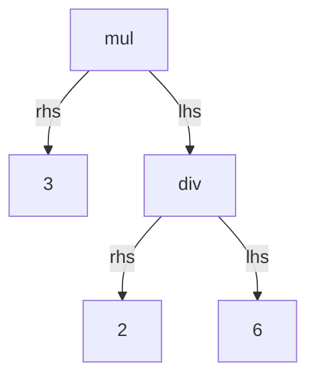
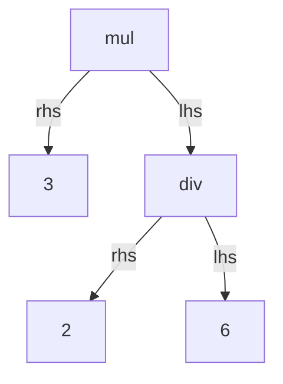

If you use graph description languages like DOT and Mermaid, you already know what makes them useful. You write down the nodes and edges and get a diagram you can embed in your docs. The source is easy to read and update, and it plays well with version control. In short, you describe what the graph contains, and the language spares you from figuring out how to draw it (e.g., computing node coordinates, routing edges, and placing labels).

Layout, however, often constitutes an important part of what the author is trying to communicate via their diagram. The figure below shows the Mermaid source for a parse tree of (6 ÷ 2) × 3 and the tree it produces.



**Did you catch it?**

If you go by where the operands are drawn, you’d be forgiven for reading this as (2 ÷ 6) × 3. The Mermaid source, however, describes (6 ÷ 2) × 3. At the division node, the lhs operand (6) is drawn on the right and the rhs operand (2) on the left. This kind of conflict between the labels and the layout makes the tree easy to misread. Ceding control over layout, therefore, also cedes control over an important part of what makes a diagram effective.

GDL authors have been asking for this kind of control for years (e.g., [mermaid#815](https://github.com/mermaid-js/mermaid/issues/815#issuecomment-1717860019), [mermaid#6438](https://github.com/mermaid-js/mermaid/issues/6438), [graphviz#1569](https://gitlab.com/graphviz/graphviz/-/issues/1569)). In the meantime, they’ve built up a whole cottage industry of hacks for steering layout in GDLs. Some, like adding [invisible edges](https://mermaid.js.org/syntax/flowchart.html#an-invisible-link), setting [ranks](https://graphviz.org/docs/attrs/rank/), or using [subgraphs](https://mermaid.js.org/syntax/flowchart.html#subgraphs), have made their way into official documentation. Others circulate as [folk knowledge](https://github.com/mermaid-js/mermaid/issues/815#issuecomment-652844554).


<details class="spytial-post-disclosure" markdown="1">
<summary>Here’s how we could use invisible edges to get the <code>lhs</code> to show up on the left and <code>rhs</code> to the right.</summary>


</details>


This cuts against the central abstraction of a graph description language. My source now contains the structure of the *actual* expression tree, plus extra graph constructs whose only job is to steer the layout. And such hacks are brittle at best. If we add another operator to the tree, we may have to figure out a new set of invisible links. We're stuck gaming the layout engine’s heuristics just to keep left operands on the left.

If where things go is part of *what* a diagram says, it should be a first-class construct in a graph description language, with well-defined semantics and guarantees. That’s why we built Spytial-GDL, a language that combines traditional graph description syntax with the lightweight, cognitively informed spatial requirements of the [Spytial language](https://blog.brownplt.org/2026/05/22/spytial.html). 

<aside id="try-spytial-gdl" class="spytial-post-actions" aria-label="Using Spytial-GDL">
  <a class="spytial-post-action" href="https://www.siddharthaprasad.com/spytial-gdl/docs/#/embedding">
    Spytial-GDL is web-native. Here’s how you can use it on your website.
  </a>
  <a class="spytial-post-action" href="https://www.siddharthaprasad.com/spytial-gdl/SKILL.md">
    Teach your AI agent to use Spytial-GDL by pointing it at this skill.
  </a>
</aside>

Here’s the same expression tree in Spytial_GDL with three layout requirements. Each operator’s left and right subtrees stay below it, on their respective sides. Nodes at the same depth share a row.

```spytial-gdl-editable
mul -->|lhs| div
mul -->|rhs| 3
div -->|rhs| 2
div -->|lhs| 6

@orientation(selector='lhs.*(lhs + rhs)', directions=[left, below])
@orientation(selector='rhs.*(lhs + rhs)', directions=[right, below])
@align(selector='{x, y: univ | #x.^~_links = #y.^~_links}', direction=horizontal)

%% Uncomment the lines below to add to the expression
%% add -->|lhs| mul
%% add -->|rhs| 10
```

Spytial-GDL is built to be completely declarative and order-independent. You can write down graph relationships *and* spatial requirements as you think of them.

This graph is live! Try dragging `2` to the left of `div`. You can’t! Spytial-GDL enforces the requirements even while you interact with the diagram. We find this particularly useful for exploration. In a more crowded diagram, readers can move things apart to follow an edge while the spatial relationships you specified still hold.

You don’t have to rewrite requirements as you grow your graph. Add more constructs to the graph by uncommenting the last two lines and clicking **Update diagram**. The `orientation` requirements on `lhs` and `rhs` apply to the new graph elements as well!


**Principled failure.** Spatial requirements can tell you something about your graph even when they can’t be met. Spytial-GDL does the principled thing and reports the conflict loudly. A layout failure is precisely when you need a diagram most. You want to look at your graph and see why it doesn’t have the shape you expected.
That’s why Spytial-GDL also draws a counterfactual showing what the same graph would look like with the conflicting requirements relaxed.

In the example below, adding an `rhs` edge from `div` back to `mul` makes each operator an operand of the other. That creates a cycle in what’s supposed to be an expression tree. A standard graph description language would draw the graph anyway, leaving the reader to spot the cycle. In a larger diagram, that’s easy to miss. In the counterfactual, you can see the cycle, with the offending node highlighted, and trace the conflict back to the rule that caused it.

```spytial-gdl
mul -->|lhs| div
mul -->|rhs| 3
div -->|rhs| 2
div -->|lhs| 6
div -->|rhs| mul

@orientation(selector='lhs.*(lhs + rhs)', directions=[left, below])
@orientation(selector='rhs.*(lhs + rhs)', directions=[right, below])
@align(selector='{x, y: univ | #x.^~_links = #y.^~_links}', direction=horizontal)
```
<hr>

<div class="spytial-post-footer-action">
  <a class="spytial-post-action" href="https://www.siddharthaprasad.com/spytial-gdl/">
    Visit the Spytial-GDL website to learn more and try it out!
  </a>
</div>


<style>

.spytial-gdl-device > div:has(> div > button[title^="Arrange the diagram by hand"]) {
  display: none;
}


.spytial-post-actions {
  display: grid;
  grid-template-columns: repeat(auto-fit, minmax(min(100%, 9rem), 1fr));
  gap: 0.75rem;
  margin: 1rem 0;
}

a.spytial-post-action {
  display: block;
  padding: 0.55rem 0.8rem;
  border: 1px solid #545454;
  box-shadow: 2px 2px 0 #545454;
  color: #242424;
  text-decoration: none;
  overflow-wrap: anywhere;
}

.spytial-post-action:hover {
  text-decoration: underline;
}

.spytial-post-action:focus-visible {
  outline: 2px solid currentColor;
  outline-offset: 4px;
}

.spytial-post-footer-action {
  display: flex;
  justify-content: center;
  margin: 1.25rem 0;
  text-align: center;
}

.spytial-post-disclosure {
  margin: 1.25rem 0;
  border: 1px solid #8a8a8a;
  border-radius: 8px;
}

.spytial-post-disclosure > summary {
  padding: 0.75rem 1rem;
  cursor: pointer;
}

.spytial-post-disclosure > summary code {
  background: transparent;
}

.spytial-post-disclosure > summary:hover {
  text-decoration: underline;
}

.spytial-post-disclosure > summary:focus-visible {
  outline: 2px solid currentColor;
  outline-offset: -3px;
}

.spytial-post-disclosure > :is(pre, .spytial-post-mermaid) {
  margin: 0 1rem 1rem;
}

.spytial-post-disclosure > .spytial-post-mermaid {
  padding: 0;
  border: 0;
}

.spytial-post-mermaid {
  display: grid;
  grid-template-columns: repeat(2, minmax(0, 1fr));
  align-items: center;
  gap: 1rem;
  margin: 1.25rem 0;
  padding: 0.875rem;
  border: 1px solid #d8dee4;
  border-radius: 6px;
  background: #fff;
}

.spytial-post-mermaid pre {
  margin: 0;
  padding: 0.75rem;
  background: #f6f8fa;
  font-size: 0.85rem;
}

.spytial-post-mermaid-preview > svg {
  display: block;
  width: 100%;
  height: auto;
  max-height: 19rem;
  margin: 0 auto;
}

@media (max-width: 600px) {
  .spytial-post-mermaid {
    grid-template-columns: minmax(0, 1fr);
  }
}
</style>

<script type="module">
  import mermaid from 'https://cdn.jsdelivr.net/npm/mermaid@12.3.0/dist/mermaid.esm.min.mjs';

  mermaid.initialize({ startOnLoad: false, layout: 'elk' });
  const blocks = document.querySelectorAll('main .language-mermaid');
  for (const [index, block] of Array.from(blocks).entries()) {
    const code = block.querySelector('code') ?? block;
    try {
      const { svg, bindFunctions } = await mermaid.render(`expression-tree-mermaid-${index}`, code.textContent.trim());
      const preview = document.createElement('div');
      preview.className = 'spytial-post-mermaid-preview';
      preview.innerHTML = svg;
      const figure = document.createElement('figure');
      figure.className = 'spytial-post-mermaid';
      const host = block.closest('pre') ?? block;
      host.replaceWith(figure);
      figure.append(host, preview);
      bindFunctions?.(preview);
    } catch (error) {
      console.error('Could not render Mermaid example:', error);
    }
  }
</script>

<script type="module">
  import { noteEngineFailure, renderSpytialGdls, sourceFromBlock } from 'https://cdn.jsdelivr.net/npm/spytial-gdl@latest/src/markdown.js';
  import { paintInto } from 'https://cdn.jsdelivr.net/npm/spytial-gdl@latest/src/highlight.js';

  const post = document.querySelector('main');
  const sources = Array.from(post.querySelectorAll('.language-spytial-gdl-editable'), sourceFromBlock);
  try {
    const diagrams = await renderSpytialGdls(post, { height: 480 });
    for (const [index, diagram] of diagrams.entries()) {
      const editor = diagram.host.closest('.spytial-gdl-device')?.querySelector('.spytial-gdl-source textarea');
      if (!editor || !sources[index]) continue;

      // The editor starts from serialized graph data, which drops ordinary comments.
      // Show the authored source initially so readers can uncomment the example edges.
      const highlightedSource = editor.previousElementSibling;
      editor.value = sources[index];
      paintInto(document, highlightedSource, editor.value, false);
      editor.parentElement.parentElement.style.height = `${Math.max(190, editor.value.split('\n').length * 20 + 24)}px`;

      // Apply the example's edge style to regenerated source. Keep manual typing intact.
      let typing = false;
      editor.addEventListener('input', () => {
        typing = true;
        setTimeout(() => { typing = false; }, 0);
      }, { capture: true });
      const formatRegeneratedSource = new MutationObserver(() => {
        if (typing) return;
        const formatted = editor.value.replace(/^(\w+) -> (\w+) : (\w+)$/gm, '$1 -->|$3| $2');
        if (formatted === editor.value) return;
        editor.value = formatted;
        paintInto(document, highlightedSource, formatted, false);
      });
      formatRegeneratedSource.observe(highlightedSource, { childList: true });
    }
  } catch (error) {
    noteEngineFailure(document, error);
  }
</script>
