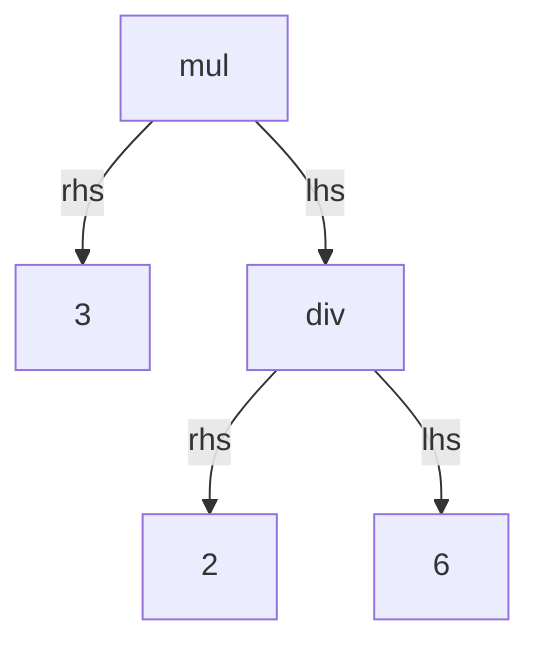
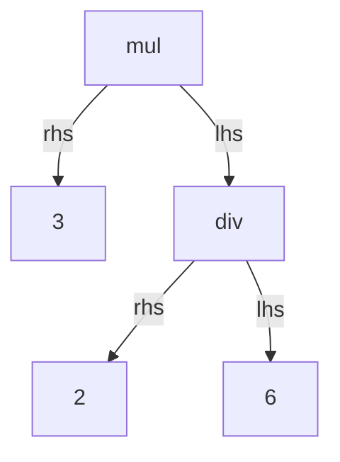

Graph description languages like Mermaid and DOT are great examples of the power of programming language design. To get a graph diagram, all you have to do is describe *what* it contains in terms of nodes and edges. The language abstracts away all the vagaries of *how* it should be drawn. The author gets an image and has a small, readable description to maintain. They can check that description into a repository and embed it in technical prose. When the graph changes, they edit the relevant bit of text and regenerate the image at build time or in the browser. That makes the diagram cheap to keep in sync with the surrounding text and code.

Layout, however, often constitutes an important part of what the author is trying to communicate via their diagram. The figure below shows the Mermaid source for a parse tree of (6 ÷ 2) × 3 and the tree it produces.



The division's `lhs` operand is drawn on the right and its `rhs` operand on the left. The positions suggest (2 ÷ 6) × 3, even though the edge labels say (6 ÷ 2) × 3. This kind of conflict between a label and its position makes this tree easy to misread. Ceding control over layout, therefore, also cedes control over an important part of what makes a diagram effective.

GDL authors have been asking for this kind of control for years (e.g., [mermaid#815](https://github.com/mermaid-js/mermaid/issues/815#issuecomment-1717860019), [mermaid#6438](https://github.com/mermaid-js/mermaid/issues/6438), [graphviz#1569](https://gitlab.com/graphviz/graphviz/-/issues/1569)). In the meantime, they’ve built up a whole cottage industry of hacks for steering layout in GDLs. Some, like adding [invisible edges](https://mermaid.js.org/syntax/flowchart.html#an-invisible-link), setting [ranks](https://graphviz.org/docs/attrs/rank/), or using [subgraphs](https://mermaid.js.org/syntax/flowchart.html#subgraphs), have made their way into official documentation. Others circulate as [folk knowledge](https://github.com/mermaid-js/mermaid/issues/815#issuecomment-652844554).

Here’s how I could use invisible edges to get the `lhs` to show up on the left and `rhs` to the right.



This cuts against the central abstraction of a graph description language. My source now contains the structure of the *actual* expression tree, plus invisible links like `3 ~~~ 2` whose only job is to steer the layout. And the hack is brittle at best. If I add another operator to the tree, I may have to figure out a new set of invisible links. I’m stuck gaming the layout engine’s heuristics just to keep left operands on the left.

If where things go is part of *what* a diagram says, it should be a first-class construct in a graph description language, with well-defined semantics and guarantees. That’s why we built Spytial-GDL, a language that combines traditional graph description syntax with the lightweight, cognitively informed spatial requirements of the [Spytial language](https://blog.brownplt.org/2026/05/22/spytial.html). Here’s the same expression tree, with two additional lines requiring every `lhs` operand below and to the left of its operator, and every `rhs` operand below and to the right.

```spytial-gdl-editable
mul -->|lhs| div
mul -->|rhs| 3
div -->|rhs| 2
div -->|lhs| 6

@orientation(selector=lhs, directions=[below, left])
@orientation(selector=rhs, directions=[below, right])

%% Uncomment the lines below to add to the expression
%% add -->|lhs| mul
%% add -->|rhs| 10
```

Spytial-GDL is built to be completely declarative and order-independent. You can write down graph relationships *and* spatial requirements as you think of them.

This graph is live! Try dragging `2` to the left of `div`. You can’t! Spytial-GDL enforces the requirements even while you interact with the diagram. We find this particularly useful for exploration. In a more crowded diagram, readers can move things apart to follow an edge while the spatial relationships you specified still hold.

You don’t have to rewrite requirements as you grow your graph. Add more constructs to the graph by uncommenting the last two lines and clicking **Update diagram**. The `orientation` requirements on `lhs` and `rhs` apply to the new graph elements as well!

**Principled failure.** When no layout can satisfy your requirements, Spytial-GDL fails loudly and shows you the problem in terms of your graph. In the example below, the `rhs` edge from `div` back to `mul` makes each operator an operand of the other. The requirements now say that each has to be above the other. Spytial-GDL highlights `mul` and `div` in the diagram, points to the two lines that asked for those placements, and shows a counterfactual layout with those requirements relaxed.

```spytial-gdl-editable
mul -->|lhs| div
mul -->|rhs| 3
div -->|rhs| 2
div -->|lhs| 6
div -->|rhs| mul

@orientation(selector=lhs, directions=[below, left])
@orientation(selector=rhs, directions=[below, right])
```

**Editable in both directions.** Edit the source and the diagram updates. Edit nodes and edges in the diagram and Spytial-GDL writes those changes back to the graph description. Try fixing the conflict in the graph above by direct manipulation. Hold Cmd or Ctrl, grab the diamond at the `mul` end of the edge from `div`, and drop it in empty space. Spytial-GDL deletes the edge, updates the source, and lays out the tree again.

**Web-native.** Spytial-GDL is built to make it easy to embed live diagrams in your own blog posts, docs, and websites. Readers can interact with them right on the page.

#### Learn more and try it out at [https://www.siddharthaprasad.com/spytial-gdl/](https://www.siddharthaprasad.com/spytial-gdl/)

<style>

.spytial-gdl-device > div:has(> div > button[title^="Arrange the diagram by hand"]) {
  display: none;
}


.spytial-post-mermaid {
  display: grid;
  grid-template-columns: repeat(2, minmax(0, 1fr));
  align-items: center;
  gap: 1rem;
  margin: 1.25rem 0;
  padding: 0.875rem;
  border: 1px solid #d8dee4;
  border-radius: 6px;
  background: #fff;
}

.spytial-post-mermaid pre {
  margin: 0;
  padding: 0.75rem;
  background: #f6f8fa;
  font-size: 0.85rem;
}

.spytial-post-mermaid-preview > svg {
  display: block;
  width: 100%;
  height: auto;
  max-height: 19rem;
  margin: 0 auto;
}

@media (max-width: 600px) {
  .spytial-post-mermaid {
    grid-template-columns: minmax(0, 1fr);
  }
}
</style>

<script type="module">
  import mermaid from 'https://cdn.jsdelivr.net/npm/mermaid@12.3.0/dist/mermaid.esm.min.mjs';

  mermaid.initialize({ startOnLoad: false, layout: 'elk' });
  const blocks = document.querySelectorAll('main .language-mermaid');
  for (const [index, block] of Array.from(blocks).entries()) {
    const code = block.querySelector('code') ?? block;
    try {
      const { svg, bindFunctions } = await mermaid.render(`expression-tree-mermaid-${index}`, code.textContent.trim());
      const preview = document.createElement('div');
      preview.className = 'spytial-post-mermaid-preview';
      preview.innerHTML = svg;
      const figure = document.createElement('figure');
      figure.className = 'spytial-post-mermaid';
      const host = block.closest('pre') ?? block;
      host.replaceWith(figure);
      figure.append(host, preview);
      bindFunctions?.(preview);
    } catch (error) {
      console.error('Could not render Mermaid example:', error);
    }
  }
</script>

<script type="module">
  import { noteEngineFailure, renderSpytialGdls, sourceFromBlock } from 'https://cdn.jsdelivr.net/npm/spytial-gdl@0.6.1/src/markdown.js';
  import { paintInto } from 'https://cdn.jsdelivr.net/npm/spytial-gdl@0.6.1/src/highlight.js';

  const post = document.querySelector('main');
  const sources = Array.from(post.querySelectorAll('.language-spytial-gdl-editable'), sourceFromBlock);
  try {
    const diagrams = await renderSpytialGdls(post, { sourceOpen: true, height: 480 });
    for (const [index, diagram] of diagrams.entries()) {
      const editor = diagram.host.closest('.spytial-gdl-device')?.querySelector('.spytial-gdl-source textarea');
      if (!editor || !sources[index]) continue;

      // The editor starts from serialized graph data, which drops ordinary comments.
      // Show the authored source initially so readers can uncomment the example edges.
      const highlightedSource = editor.previousElementSibling;
      editor.value = sources[index];
      paintInto(document, highlightedSource, editor.value, false);
      editor.parentElement.parentElement.style.height = `${Math.max(190, editor.value.split('\n').length * 20 + 24)}px`;

      // Apply the example's edge style to regenerated source. Keep manual typing intact.
      let typing = false;
      editor.addEventListener('input', () => {
        typing = true;
        setTimeout(() => { typing = false; }, 0);
      }, { capture: true });
      const formatRegeneratedSource = new MutationObserver(() => {
        if (typing) return;
        const formatted = editor.value.replace(/^(\w+) -> (\w+) : (\w+)$/gm, '$1 -->|$3| $2');
        if (formatted === editor.value) return;
        editor.value = formatted;
        paintInto(document, highlightedSource, formatted, false);
      });
      formatRegeneratedSource.observe(highlightedSource, { childList: true });
    }
  } catch (error) {
    noteEngineFailure(document, error);
  }
</script>
